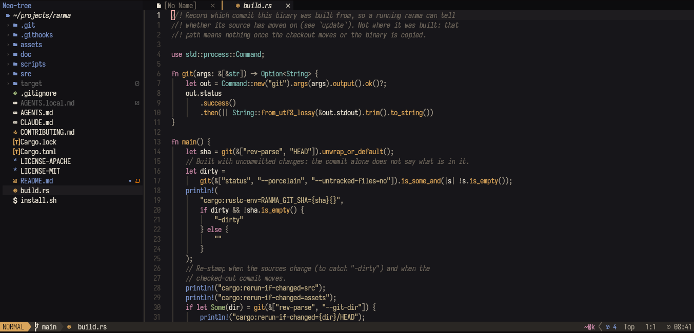

# sumi.nvim



Ink, washi paper and hinoki wood: the editor half of ranma's `sumi` and
`kanna` themes. Two colorschemes, one palette:

- **sumi** — airy. The ground of ranma's focused pane (`#17161a`), inactive
  windows fade to `#121114`, a soft cursorline, floats on ink.
- **kanna** — dense. One ink ground everywhere (`#141317`), flat square
  status line on `#1e1c1a`, the darker `#2e2b27` separators, no cursorline
  wash: the current line number turns hinoki instead.

Syntax colours are the same in both, so code reads alike in either.

## Install

lazy.nvim:

```lua
{ "masshirodev/sumi.nvim", lazy = false, priority = 1000,
  config = function()
    require("sumi").setup({ transparent = false, dim_inactive = true })
    vim.cmd.colorscheme("sumi")   -- or "kanna"
  end },
```

Or copy `colors/` and `lua/` into `~/.config/nvim/`.

lualine: `require("lualine").setup { options = { theme = "sumi" } }` (or
`"kanna"`).

To follow ranma's choice, pick the scheme from an environment variable.
ranma does not export one for its theme yet, so set `RANMA_THEME` yourself
where you choose ranma's theme:

```lua
vim.cmd.colorscheme(os.getenv("RANMA_THEME") == "kanna" and "kanna" or "sumi")
```

## Options

| Option | Default | |
| --- | --- | --- |
| `transparent` | `false` | leave the ground to the terminal (and ranma's `panes.active_bg`) |
| `dim_inactive` | `true` | sumi: inactive windows take `#121114`, like ranma's unfocused panes (kanna keeps one ground) |
| `italic_comments` | `true` | |

## Palette

| | | |
| --- | --- | --- |
| washi `#e8e1d3` text | hinoki `#d9a55b` functions | sakura `#c98aa8` keywords |
| aonori `#7fb8b0` types | matcha `#9db37a` numbers, constants | kincha `#c4b28a` strings |
| ai `#7b93c9` macros, floats | shu `#e0533d` errors | kasumi `#6e665c` comments |

`require("sumi").colors("kanna")` (or `"sumi"`) hands a variant's colours to
anything else.

## Checking a change

```sh
nvim --headless -u NONE -l scripts/check.lua
```

loads every colorscheme and lualine theme in a clean Neovim and fails on the
first error. CI runs it on every push and pull request, against the latest
Neovim release and nightly.

## License

MIT, see `LICENSE`.
